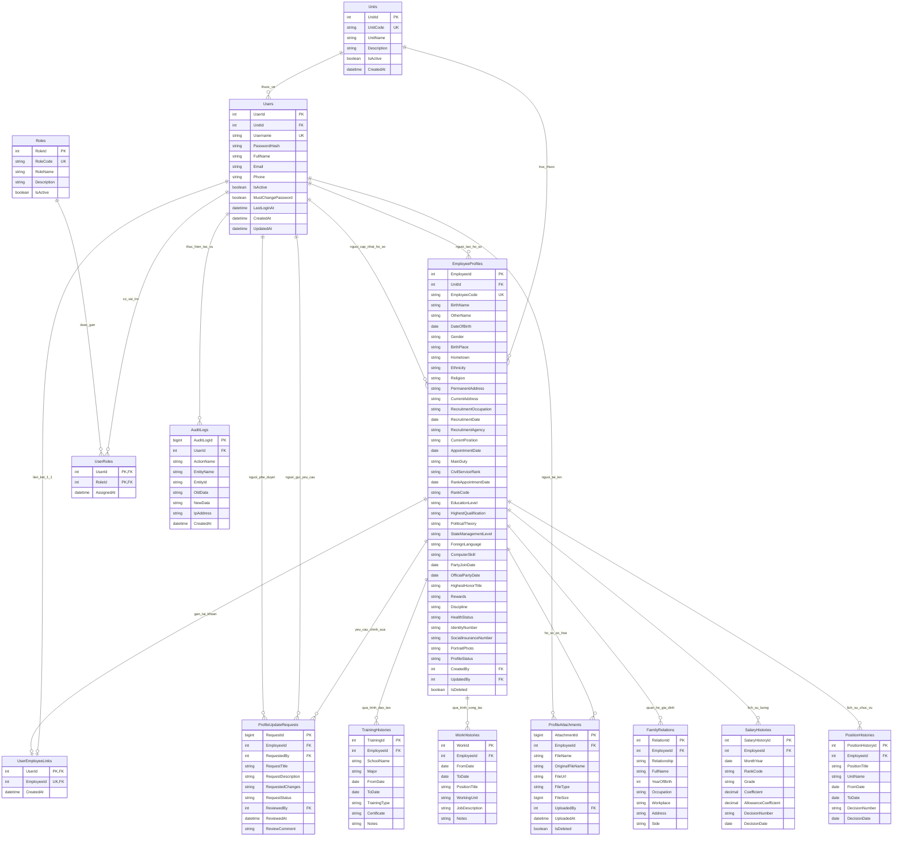

# Sơ Đồ Thực Thể Quan Hệ (ERD) - Hệ Thống Quản Lý Cán Bộ, Công Chức, Viên Chức

## 1. Sơ Đồ ERD Trực Quan (Entity Relationship Diagram)

---

## 2. Danh Sách & Mô Tả Chi Tiết 14 Bảng Thực Thể

| STT | Tên Bảng (Entity) | Khóa Chính (PK) | Khóa Ngoại (FK) | Ý Nghĩa Nghiệp Vụ |
|:---:|:---|:---|:---|:---|
| 1 | **Units** | `UnitId` | Không | Quản lý cây phòng ban / đơn vị trực thuộc cơ quan |
| 2 | **Roles** | `RoleId` | Không | Danh mục vai trò trong hệ thống (ADMIN, HR_MANAGER, UNIT_MANAGER, HR_OFFICER, EMPLOYEE) |
| 3 | **Users** | `UserId` | `UnitId` | Tài khoản đăng nhập hệ thống, mật khẩu mã hóa BCrypt |
| 4 | **UserRoles** | `UserId, RoleId` | `UserId, RoleId` | Phân quyền đa vai trò (N - N giữa Users và Roles) |
| 5 | **EmployeeProfiles** | `EmployeeId` | `UnitId, CreatedBy, UpdatedBy` | Bảng lõi quản lý đầy đủ thông tin sơ yếu lý lịch cán bộ, công chức, viên chức (mẫu 2C-BNV/2008 và chuẩn TT 06/2023/TT-BNV) |
| 6 | **UserEmployeeLinks** | `UserId` | `UserId, EmployeeId` | Liên kết 1 - 1 giữa tài khoản đăng nhập và hồ sơ cá nhân |
| 7 | **TrainingHistories** | `TrainingId` | `EmployeeId` | Quá trình đào tạo, bồi dưỡng chuyên môn, văn bằng, chứng chỉ |
| 8 | **WorkHistories** | `WorkId` | `EmployeeId` | Quá trình công tác, cơ quan, chức vụ và nhiệm vụ đảm nhiệm |
| 9 | **FamilyRelations** | `RelationId` | `EmployeeId` | Quan hệ gia đình (về bản thân: bố, mẹ, vợ/chồng, con; và về bên vợ/chồng) |
| 10 | **SalaryHistories** | `SalaryHistoryId` | `EmployeeId` | Quá trình diễn biến tiền lương: ngạch, bậc, hệ số, phụ cấp và số quyết định |
| 11 | **PositionHistories** | `PositionHistoryId` | `EmployeeId` | Lịch sử bổ nhiệm, điều động, giữ các chức vụ lãnh đạo/quản lý |
| 12 | **ProfileAttachments** | `AttachmentId` | `EmployeeId, UploadedBy` | Số hóa hồ sơ: tài liệu, bằng cấp scan, quyết định bổ nhiệm, ảnh thẻ |
| 13 | **ProfileUpdateRequests** | `RequestId` | `EmployeeId, RequestedBy, ReviewedBy` | Quy trình tiếp nhận, phê duyệt đề xuất chỉnh sửa thông tin hồ sơ (lưu delta dưới dạng JSON) |
| 14 | **AuditLogs** | `AuditLogId` | `UserId` | Nhật ký hoạt động toàn hệ thống (Audit Trail) phục vụ giám sát, bảo mật |

---

## 3. Các Ràng Buộc Dữ Liệu Quan Trọng (Constraints & Rules)

1. **Ràng buộc toàn vẹn quan hệ (Referential Integrity):**
   - Không được xóa đơn vị (`Units`) khi còn hồ sơ công chức thuộc đơn vị đó.
   - Khi xóa hồ sơ công chức (`EmployeeProfiles`), thực hiện **Xóa mềm (Soft Delete)** qua cờ `IsDeleted = 1`, không xóa vật lý để bảo toàn lịch sử công tác và kiểm toán.
2. **Ràng buộc kiểm tra (Check Constraints):**
   - Giới tính: `Nam`, `Nữ`, `Khác`.
   - Chiều cao `HeightCm > 0`, Cân nặng `WeightKg > 0`.
   - Ngày sinh `DateOfBirth <= ngày hiện tại`.
   - Trạng thái hồ sơ: `DRAFT`, `PENDING`, `APPROVED`, `REJECTED`, `ACTIVE`, `INACTIVE`.
   - Thời gian đào tạo & công tác: `ToDate >= FromDate`.
   - Chu kỳ lương: `DAY(MonthYear) = 1` (chuẩn hóa về ngày mùng 1 hàng tháng).
   - Dữ liệu đề xuất thay đổi: `ISJSON(RequestedChanges) = 1`.

