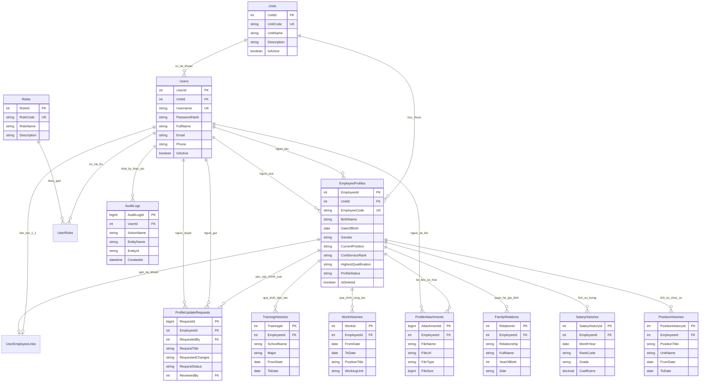

# HỆ THỐNG QUẢN LÝ HỒ SƠ CÁN BỘ, CÔNG CHỨC, VIÊN CHỨC

> **Repository:** [https://github.com/VanThan19/QuanLyCongChucVien](https://github.com/VanThan19/QuanLyCongChucVien)  
> **Tác giả:** Nguyễn Văn Thân (VanThan19)  
> **Đơn vị đào tạo:** Trường Đại học Vinh (Vinh University)  

---

## 1. MỤC TIÊU ĐỀ TÀI

### 1.1. Mục tiêu tổng quát
Xây dựng một hệ thống phần mềm web ứng dụng hoàn chỉnh, hiện đại và bảo mật cao nhằm **số hóa, chuẩn hóa và tự động hóa toàn diện quy trình quản lý hồ sơ cán bộ, công chức, viên chức** theo đúng tiêu chuẩn nghiệp vụ của Bộ Nội vụ (mẫu sơ yếu lý lịch 2C-BNV/2008 và Thông tư 06/2023/TT-BNV).

### 1.2. Mục tiêu cụ thể
1. **Số hóa hồ sơ nhân sự:** Lưu trữ tập trung, đồng bộ toàn bộ lý lịch cá nhân, bằng cấp, chứng chỉ scan số hóa, quá trình công tác, lịch sử lương, lịch sử bổ nhiệm chức vụ và quan hệ gia đình.
2. **Phân quyền đa tầng theo 5 nhóm vai trò (Role-based Access Control - RBAC):**
   - **Quản trị hệ thống (Admin):** Cấu hình cơ cấu tổ chức, quản lý tài khoản, phân quyền, giám sát nhật ký kiểm toán (Audit Logs).
   - **Quản lý nhân sự (HR Manager):** Phê duyệt các biến động nhân sự, điều chuyển công tác, nâng lương, thăng hạng chức danh nghề nghiệp toàn cơ quan.
   - **Trưởng đơn vị (Unit Manager):** Theo dõi cơ cấu nhân sự, giám sát và xác nhận sơ bộ các đề xuất của cán bộ trong phạm vi đơn vị mình quản lý.
   - **Cán bộ tổ chức (HR Officer):** Tiếp nhận, nhập liệu, cập nhật hồ sơ, số hóa văn bản đính kèm, lập báo cáo thống kê định kỳ.
   - **Cán bộ, công chức, viên chức (Employee):** Tự tra cứu lý lịch cá nhân mọi lúc mọi nơi; chủ động gửi yêu cầu cập nhật khi có thay đổi thông tin (bổ sung bằng cấp, đổi địa chỉ, thay đổi quá trình công tác).
3. **Quy trình phê duyệt minh bạch & linh hoạt (Workflow Approval):**
   - Thay đổi thông tin từ cá nhân được kiểm tra cú pháp JSON, đối soát sự khác biệt (Diff viewer) và lưu lại lịch sử duyệt.
   - Tự động đồng bộ vào hồ sơ gốc ngay sau khi được cấp có thẩm quyền phê duyệt.
4. **Bảo mật và Giám sát vết (Security & Audit Trail):**
   - Xác thực an toàn bằng JWT kết hợp mã Captcha phòng chống tấn công dò mật khẩu.
   - Mọi thao tác thêm/sửa/xóa đều được lưu vết chi tiết (UserId, thời gian, IP, dữ liệu cũ - mới) vào bảng `AuditLogs`.

---

## 2. SƠ ĐỒ THỰC THỂ QUAN HỆ (ERD - ENTITY RELATIONSHIP DIAGRAM)

Hệ thống được thiết kế chuẩn hóa mức 3NF với **14 bảng thực thể** liên kết chặt chẽ:



> Chi tiết các thuộc tính, ràng buộc CHECK và mối quan hệ được mô tả chi tiết tại tài liệu [ERD_DIAGRAM.md](./ERD_DIAGRAM.md).

---

## 3. KIẾN TRÚC CÔNG NGHỆ (TECH STACK)

| Thành phần | Công nghệ / Thư viện | Mô tả |
|:---|:---|:---|
| **Frontend** | React 19, Vite, Tailwind CSS v4 | Giao diện Single Page Application (SPA), phong cách Cổng thông tin điện tử hành chính công |
| **Routing & State** | React Router v7, React Context API | Phân luồng điều hướng và bảo vệ tuyến đường phân hệ (Route Guard) |
| **Icons & UI** | Lucide React | Hệ thống biểu tượng giao diện trực quan |
| **Backend** | Java 17+, Spring Boot 3.x | Xây dựng RESTful API kiến trúc đa tầng (Controller - Service - Repository) |
| **Bảo mật** | Spring Security 6, JWT, BCrypt | Xác thực phi trạng thái (Stateless), mã hóa một chiều, phân quyền theo vai trò |
| **Cơ sở dữ liệu** | Microsoft SQL Server 2019+ | Hệ quản trị cơ sở dữ liệu quan hệ, hỗ trợ trigger, JSON, index tối ưu hóa |
| **Quản trị dự án** | Git, GitHub Issues, Agile/Scrum | Quản lý mã nguồn và tiến độ theo mô hình 1 Task = 1 Issue |

---

## 4. CẤU TRÚC THƯ MỤC DỰ ÁN

```text
QuanLyCongChucVien/
├── .github/
│   └── ISSUE_TEMPLATE/
│       └── task_issue_template.md    # Mẫu tạo GitHub Issue chuẩn cho từng Task
├── back-end/
│   └── cong-vien-chuc/               # Dự án Spring Boot Backend
│       ├── src/main/java/com/vanthan/congvienchuc/
│       │   ├── config/               # Cấu hình Security, CORS, Swagger
│       │   ├── controller/           # Các REST API Endpoints
│       │   ├── dto/                  # Data Transfer Objects & Requests
│       │   ├── entity/               # Các lớp JPA ánh xạ bảng CSDL
│       │   ├── repository/           # Tầng truy xuất dữ liệu JPA
│       │   ├── security/             # Xử lý JWT & Phân quyền
│       │   └── service/              # Nghiệp vụ xử lý logic
│       ├── src/main/resources/
│       │   └── application.properties# Cấu hình kết nối SQL Server, JWT secret
│       └── pom.xml                   # Cấu hình dependencies Maven
├── front-end/                        # Dự án React 19 + Vite Frontend
│   ├── src/
│   │   ├── config/roles.js           # Định nghĩa 5 vai trò và phân quyền tuyến đường
│   │   ├── roles/                    # Giao diện nghiệp vụ theo từng vai trò
│   │   │   ├── admin/                # Phân hệ Quản trị viên
│   │   │   ├── employee/             # Phân hệ Cán bộ, công chức
│   │   │   ├── hr-manager/           # Phân hệ Quản lý nhân sự
│   │   │   ├── hr-officer/           # Phân hệ Cán bộ tổ chức
│   │   │   └── unit-manager/         # Phân hệ Quản lý đơn vị
│   │   ├── shared/                   # Thành phần giao diện dùng chung
│   │   │   ├── auth/                 # AuthProvider, RequireAuth, useAuth
│   │   │   ├── components/           # Header, Sidebar, Modal
│   │   │   └── pages/login/          # Trang đăng nhập & mã Captcha
│   │   ├── App.jsx                   # Điều hướng chính React Router
│   │   └── main.jsx
│   ├── package.json
│   └── vite.config.js
├── CSDL.sql                          # Kịch bản DDL/DML khởi tạo cơ sở dữ liệu SQL Server
├── ERD_DIAGRAM.md                    # Tài liệu Sơ đồ thực thể quan hệ chi tiết
├── PROJECT_TASKS_ISSUES.md           # Bảng phân rã 28 Task = 28 Issue chi tiết
└── README.md                         # Tài liệu giới thiệu tổng quan dự án
```

---

## 5. HƯỚNG DẪN CÀI ĐẶT VÀ KHỞI CHẠY

### 5.1. Khởi tạo Cơ sở dữ liệu SQL Server
1. Mở công cụ **SQL Server Management Studio (SSMS)** hoặc **Azure Data Studio**.
2. Kết nối tới SQL Server instance của bạn (ví dụ: `localhost`).
3. Mở tệp tin `CSDL.sql` và bấm **Execute (F5)** để tự động tạo cơ sở dữ liệu `QuanLyCongChuc`, các bảng và dữ liệu mẫu (10 đơn vị, 5 vai trò).

### 5.2. Chạy ứng dụng Backend (Spring Boot)
1. Mở thư mục `back-end/cong-vien-chuc`.
2. Kiểm tra thông tin kết nối trong file `src/main/resources/application.properties`:
   ```properties
   spring.datasource.url=jdbc:sqlserver://localhost:1433;databaseName=QuanLyCongChuc;encrypt=true;trustServerCertificate=true
   spring.datasource.username=sa
   spring.datasource.password=YourPassword
   server.port=8080
   ```
3. Khởi chạy ứng dụng:
   ```bash
   cd back-end/cong-vien-chuc
   ./mvnw spring-boot:run
   ```
   Ứng dụng sẽ chạy tại: `http://localhost:8080`.

### 5.3. Chạy ứng dụng Frontend (React + Vite)
1. Mở thư mục `front-end`.
2. Cài đặt các thư viện phụ thuộc:
   ```bash
   cd front-end
   npm install
   ```
3. Chạy môi trường phát triển:
   ```bash
   npm run dev
   ```
4. Truy cập giao diện tại: `http://localhost:5173`.

---

## 6. QUẢN TRỊ CÔNG VIỆC DỰ ÁN (PROJECT TASKS & ISSUES)

Dự án được phân rã thành **28 Task / Issues** cụ thể theo chuẩn Agile:
Mỗi Task quy định rõ ràng:
- **Mô tả công việc**
- **Thời gian hoàn thành (Timeline)**
- **Input:** Là ai - Cái gì - Làm gì - Ở đâu
- **Output:** Cần gì - Làm gì - Kết quả đã đạt chưa (Acceptance Criteria)
- **Tên người thực thi (Assignee)**

👉 Xem bảng chi tiết toàn bộ các task tại: [PROJECT_TASKS_ISSUES.md](./PROJECT_TASKS_ISSUES.md).

---

## 7. CÁC TÀI KHOẢN MẪU THỬ NGHIỆM (DEMO ACCOUNTS)

| Vai trò (Role) | Mã vai trò | Quyền hạn chính | Đường dẫn phân hệ |
|:---|:---|:---|:---|
| **Quản trị hệ thống** | `ADMIN` | Quản lý tài khoản, đơn vị, phân quyền, xem audit log | `/admin` |
| **Quản lý nhân sự** | `HR_MANAGER` | Xem xét, phê duyệt biến động nhân sự, báo cáo toàn cơ quan | `/hr-manager` |
| **Quản lý đơn vị** | `UNIT_MANAGER` | Giám sát nhân sự nội bộ phòng ban, duyệt sơ bộ đề xuất | `/unit-manager` |
| **Cán bộ tổ chức** | `HR_OFFICER` | Nhập liệu, cập nhật hồ sơ, số hóa giấy tờ scan | `/hr-officer` |
| **Cán bộ công chức** | `EMPLOYEE` | Xem sơ yếu lý lịch cá nhân, gửi đề xuất cập nhật | `/employee/ho-so-ca-nhan` |

---

## 8. BẢN QUYỀN & TÁC GIẢ

- **Tác giả:** Nguyễn Văn Thân
- **Email:** 235748020110172@vinhuni.edu.vn / vanthan@vinhuni.edu.vn
- **GitHub:** [https://github.com/VanThan19](https://github.com/VanThan19)
- **Mã nguồn dự án:** [https://github.com/VanThan19/QuanLyCongChucVien](https://github.com/VanThan19/QuanLyCongChucVien)

